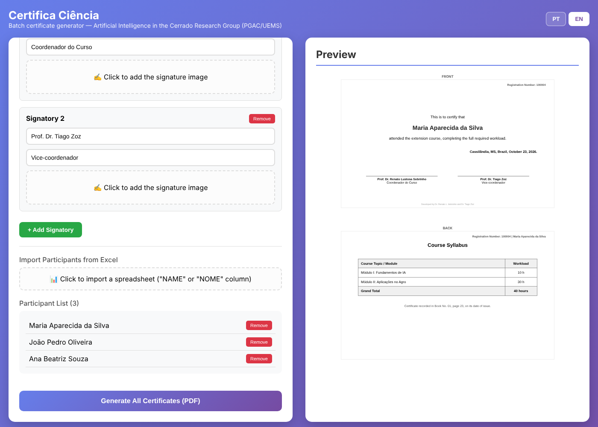

# Certifica Ciência

**A bilingual (Portuguese/English) batch certificate generator that runs entirely in the web browser.**

[🇧🇷 Português](README.md) · 🇬🇧 English

Developed by the **Artificial Intelligence in the Cerrado Research Group**, Graduate Program in Agronomy (PGAC), State University of Mato Grosso do Sul (UEMS), Brazil.



---

## Contents

1. [What it is](#1-what-it-is)
2. [Main features](#2-main-features)
3. [How to access](#3-how-to-access)
4. [Step-by-step tutorial](#4-step-by-step-tutorial)
5. [Spreadsheet template](#5-spreadsheet-template)
6. [Data privacy](#6-data-privacy)
7. [Frequently asked questions](#7-frequently-asked-questions)
8. [Repository structure](#8-repository-structure)
9. [How to cite](#9-how-to-cite)
10. [License](#10-license)

---

## 1. What it is

**Certifica Ciência** produces PDF certificates for every participant of a course, event, workshop or extension project in a single run. Configure the template once (texts, logos, signatures and syllabus), import a spreadsheet with the names and click **Generate**. Certificates are numbered sequentially, and a registry table is produced that can be exported to Excel for institutional record-keeping.

The whole system is a single HTML file: no installation, server, database or sign-up is required.

## 2. Main features

- **Portuguese and English** interface, switched with one button (PT/EN);
- Custom **background image** for the certificate front;
- Up to **two logos in each corner** (eight in total);
- **Signatures** with name, position and scanned signature image (as many signatories as needed);
- Optional **back page** with a syllabus table and workload;
- **Participant import** from Excel (.xlsx, .xls) or CSV;
- **Sequential registration numbers**, starting from a user-defined number;
- Real-time **preview**;
- One **PDF per participant**, A4 landscape;
- **Registry table** of issued certificates, exportable to Excel.

## 3. How to access

### Option A — Online (recommended)

Open the GitHub Pages address:

**https://renatolustosa-uems.github.io/certifica-ciencia/?lang=en**

### Option B — On your own computer

1. On the repository page, click **Code → Download ZIP**;
2. Unzip the file;
3. Double-click `index.html`. The system opens in your browser.

> **Requirement:** an up-to-date browser (Chrome, Edge, Firefox or Safari) and an internet connection while in use, since the PDF and spreadsheet libraries are loaded from public CDNs.

## 4. Step-by-step tutorial

### Step 1 — Choose the language

In the upper-right corner, click **PT** (Portuguese) or **EN** (English). The default certificate texts change with the language as long as you have not edited them; any text you have typed is kept.

### Step 2 — Add a background (optional)

Under **Background Image (Front)**, click the dashed area and select an image (PNG or JPG). For best results, use a landscape image of about **1000 × 600 pixels** or larger, with decorated borders and a light centre so the text remains legible. Click **Remove Background** to discard it.

### Step 3 — Insert the logos

Under **Corner Logos** there are four corners (top left, top right, bottom left, bottom right), each with two slots. Click a slot and choose the logo of the institution, programme, research group or funding agency. **PNG files with a transparent background** work best. Click the red **X** to remove a logo.

### Step 4 — Set the starting registration number

Under **Starting Registration Number**, enter the number of the first certificate (default: 100001). The following ones are numbered sequentially. After each run, the field is updated to the next free number, preventing duplicates in later batches.

### Step 5 — Write the texts

- **Main Text:** appears above the participant's name (e.g., "This is to certify that");
- **Additional Text:** appears below the name (e.g., "attended the extension course…, with a total workload of 40 hours");
- **Place and Date:** right-aligned (e.g., "Cassilândia, MS, Brazil, October 23, 2026.");
- **Event / Course Name:** not printed on the certificate; used only in the registry table.

Press **Enter** to break a line.

#### Formatting passages (bold, italic, underline and size)

The **Main Text**, **Additional Text**, **Place and Date** and **Back Page Footer Text** fields have a formatting toolbar:

| Button | Function |
|---|---|
| **B** | Bold |
| *I* | Italic |
| U | Underline |
| Size | Changes the font size of the selected passage (10 to 48 px) |
| ✕ | Clears formatting from the selected passage |

**Select the passage with the mouse** and click the desired button. Text pasted from other programs (Word, e-mail) is inserted without formatting so the layout is not disturbed.

The **Participant Name Font Size** field sets the name size on all certificates (default: 28 px). Reduce it for very long names.

### Step 6 — Configure the back page (optional)

Tick **Generate Back Page**. Then:

1. Type each module or topic and its workload, and click **Add**;
2. Fill in the **Total Workload**, shown in the last row of the table;
3. Edit the **Back Page Footer Text** (e.g., registry book and page).

The back page also shows the registration number and participant's name, so both pages always match.

### Step 7 — Configure the signatures

Under **Signatures**, fill in each signatory's **name** and **position**. Click the dashed area to insert the **signature image** (preferably a high-resolution PNG with a transparent background). Use **+ Add Signatory** to add more people, or **Remove** to delete one.

### Step 8 — Import the participants

Click **Import Participants from Excel** and select the spreadsheet. The system reads the **first sheet** and looks for a **NAME** column (NOME, ALUNO and STUDENT are also accepted; if none exists, the first column is used). The number of imported names appears under **Participant List**. Click **Remove** to exclude someone.

### Step 9 — Check the preview

The right-hand panel shows, in real time, the certificate of the first participant in the list. Review spelling, alignment and logos before generating.

### Step 10 — Generate the certificates

Click **Generate All Certificates (PDF)**. A progress bar shows the status. Each certificate is downloaded as a separate file named:

```
certificate_100001_Participant_Name.pdf
```

> **Note:** the first time, your browser may ask whether to allow **multiple downloads**. Click **Allow**. If only one file is downloaded, check the blocked-download icon in the address bar.

### Step 11 — Export the registry

At the end, the **Generated Certificates Registry** section lists the number, name, event and date of every certificate issued. Click **Export to Excel** to save `Certificate_Registry.xlsx` and file it with the event records.


## 5. Spreadsheet template

The [`exemplos/`](exemplos/) folder contains ready-to-use templates:

| File | Language | Column |
|---|---|---|
| `participants_template.xlsx` | English | `NAME` |
| `modelo_participantes.xlsx` | Portuguese | `NOME` |

Expected layout (one name per row, starting at row 2):

| NAME |
|---|
| Mary Johnson |
| John Smith |
| Anna Brown |

## 6. Data privacy

All processing takes place **in the user's browser**. Names, images and signatures are **never sent to any server** and are not stored after the page is closed. The only information saved locally is the chosen language. This design is consistent with the principles of the Brazilian General Data Protection Law (LGPD, Law No. 13,709/2018) and the EU GDPR.

## 7. Frequently asked questions

**Certificates come out blank or without images.**
Check your internet connection (needed to load the libraries) and make sure images are PNG or JPG.

**Only one certificate was downloaded.**
The browser blocked multiple downloads. Allow them in the site permissions and generate again, adjusting the starting registration number if needed.

**Can I save the template for later?**
Not in this version. Keep the images (background, logos, signatures) and texts in a folder so you can reconfigure quickly.

**A very long name does not fit on one line.**
The line wraps automatically; check the result in the preview.

## 8. Repository structure

```
certifica-ciencia/
├── index.html                  # The application (single file)
├── README.md                   # Tutorial in Portuguese
├── README.en.md                # Tutorial in English
├── LICENSE                     # MIT License
├── CITATION.cff                # Citation metadata
├── .zenodo.json                # Zenodo deposit metadata
├── CHANGELOG.md                # Version history
├── docs/                       # Screenshots used in the tutorial
└── exemplos/                   # Participant spreadsheet templates
```

## 9. How to cite

Lustosa Sobrinho, R., Zoz, T., Bobadilha, E. L., Rosa, E. C. F., Costa, E., Vieira, G. H. C., Seron, C. C., Martins, M. B., Oliveira, C. E. S., Neves, V. A., Barboza Junior, L. A., Oliveira, B. R., Fronk, B. A., & Santos, T. M. (2026). *Certifica Ciência: a bilingual batch certificate generator* (Version 1.1.0) [Computer software]. Artificial Intelligence in the Cerrado Research Group, PGAC/UEMS. https://doi.org/10.5281/zenodo.XXXXXXX

> The DOI will be assigned by Zenodo once the first release is published on GitHub.

## 10. License

Released under the **MIT License**. See [LICENSE](LICENSE).

Third-party libraries keep their own licences: [html2canvas](https://html2canvas.hertzen.com/) (MIT), [jsPDF](https://github.com/parallax/jsPDF) (MIT) and [SheetJS](https://sheetjs.com/) (Apache 2.0).

---

**Authors:**

- Renato Lustosa Sobrinho — [ORCID 0000-0003-2176-6745](https://orcid.org/0000-0003-2176-6745)
- Tiago Zoz — [ORCID 0000-0003-2991-5485](https://orcid.org/0000-0003-2991-5485)
- Edson de Lima Bobadilha
- Elen Cristina Fernandes Rosa
- Edilson Costa — [ORCID 0000-0002-4584-6611](https://orcid.org/0000-0002-4584-6611)
- Gustavo Haralampidou da Costa Vieira — [ORCID 0000-0002-6234-3696](https://orcid.org/0000-0002-6234-3696)
- Cássio de Castro Seron — [ORCID 0000-0003-4289-931X](https://orcid.org/0000-0003-4289-931X)
- Murilo Battistuzzi Martins — [ORCID 0000-0002-8759-0917](https://orcid.org/0000-0002-8759-0917)
- Carlos Eduardo da Silva Oliveira — [ORCID 0000-0002-3894-9559](https://orcid.org/0000-0002-3894-9559)
- Vitor Augusto Neves
- Levi Alves Barboza Junior
- Bruno Rodrigues de Oliveira (UNESP) — [ORCID 0000-0002-1037-6541](https://orcid.org/0000-0002-1037-6541)
- Bruno Aparecido Fronk
- Thiago Martins dos Santos

**Research group:** [Artificial Intelligence in the Cerrado — CNPq Research Groups Directory](http://dgp.cnpq.br/dgp/espelhogrupo/2871755427518068)
**Contact:** renatolustosa@uems.br
