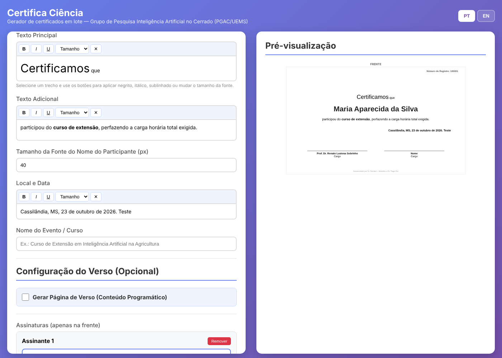
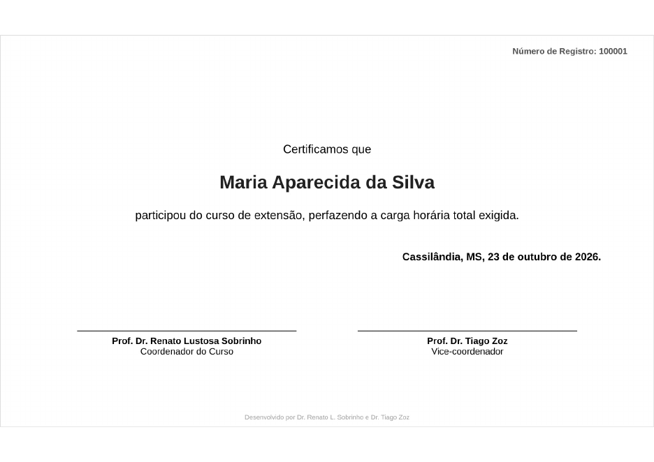
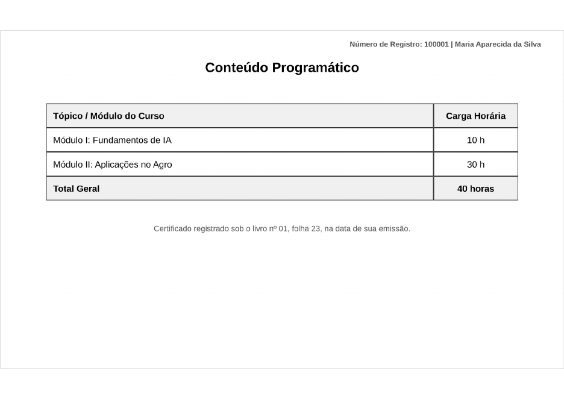

# Certifica Ciência

**Gerador de certificados em lote, bilíngue (português/inglês), que funciona inteiramente no navegador.**

🇧🇷 Português · [🇬🇧 English](README.en.md)

Desenvolvido pelo **Grupo de Pesquisa Inteligência Artificial no Cerrado**, do Programa de Pós-Graduação em Agronomia (PGAC) da Universidade Estadual de Mato Grosso do Sul (UEMS).



---

## Sumário

1. [O que é](#1-o-que-é)
2. [Principais recursos](#2-principais-recursos)
3. [Como acessar](#3-como-acessar)
4. [Tutorial passo a passo](#4-tutorial-passo-a-passo)
5. [Modelo de planilha](#5-modelo-de-planilha)
6. [Privacidade dos dados](#6-privacidade-dos-dados)
7. [Perguntas frequentes](#7-perguntas-frequentes)
8. [Estrutura do repositório](#8-estrutura-do-repositório)
9. [Como citar](#9-como-citar)
10. [Licença](#10-licença)

---

## 1. O que é

O **Certifica Ciência** gera, de uma só vez, certificados em PDF para todos os participantes de um curso, evento, minicurso ou projeto de extensão. Basta configurar o modelo uma vez (textos, logotipos, assinaturas e conteúdo programático), importar uma planilha com os nomes e clicar em **Gerar**. O sistema numera os certificados em sequência e produz uma tabela de registro que pode ser exportada para o Excel, facilitando o controle institucional.

O sistema é um único arquivo HTML: não exige instalação, servidor, banco de dados nem cadastro.

## 2. Principais recursos

- Interface em **português e inglês**, com troca de idioma por um botão (PT/EN);
- Imagem de **plano de fundo** personalizada para a frente do certificado;
- Até **dois logotipos em cada canto** do certificado (oito no total);
- **Assinaturas** com nome, cargo e imagem da assinatura digitalizada (quantos assinantes forem necessários);
- **Verso opcional** com tabela de conteúdo programático e carga horária;
- **Importação de participantes** a partir de planilha Excel (.xlsx, .xls) ou CSV;
- **Numeração sequencial** de registro, a partir de um número inicial definido pelo usuário;
- **Pré-visualização** em tempo real;
- Um **PDF por participante**, em formato A4 paisagem;
- **Tabela de registros** dos certificados emitidos, exportável para Excel.

## 3. Como acessar

### Opção A — Online (recomendado)

Acesse o endereço publicado no GitHub Pages:

**https://renatolustosa-uems.github.io/certifica-ciencia/**

> Para abrir diretamente em inglês, acrescente `?lang=en` ao endereço.

### Opção B — No próprio computador

1. Na página do repositório, clique em **Code → Download ZIP**;
2. Descompacte o arquivo;
3. Dê um duplo clique em `index.html`. O sistema abrirá no navegador.

> **Requisito:** navegador atualizado (Chrome, Edge, Firefox ou Safari) e conexão com a internet no momento do uso, pois as bibliotecas de geração de PDF e leitura de planilhas são carregadas de servidores públicos (CDN).

## 4. Tutorial passo a passo

### Passo 1 — Escolha o idioma

No canto superior direito, clique em **PT** (português) ou **EN** (inglês). Os textos padrão do certificado mudam junto com o idioma, desde que você ainda não os tenha editado. Textos que você já digitou são mantidos.

### Passo 2 — Adicione o plano de fundo (opcional)

Em **Imagem de Plano de Fundo (Frente)**, clique na área tracejada e escolha uma imagem (PNG ou JPG). Para melhor resultado, use uma imagem em proporção paisagem de aproximadamente **1000 × 600 pixels** ou maior, com as bordas decoradas e o centro claro, para não prejudicar a leitura do texto. Para retirar a imagem, clique em **Remover Fundo**.

### Passo 3 — Insira os logotipos

Em **Logos nos Cantos**, há quatro cantos (superior esquerdo, superior direito, inferior esquerdo e inferior direito), cada um com dois espaços. Clique em um espaço e escolha a imagem do logotipo da instituição, do programa, do grupo de pesquisa ou do órgão de fomento. Prefira arquivos **PNG com fundo transparente**. Para remover um logotipo, clique no **X** vermelho.

### Passo 4 — Defina o número inicial de registro

Em **Número Inicial de Registro**, informe o número do primeiro certificado (padrão: 100001). Os seguintes são numerados em sequência. Após cada geração, o campo é atualizado automaticamente para o próximo número livre, o que evita repetições em emissões posteriores.

### Passo 5 — Redija os textos

- **Texto Principal:** aparece acima do nome do participante (ex.: "Certificamos que");
- **Texto Adicional:** aparece abaixo do nome (ex.: "participou do curso de extensão…, com carga horária de 40 horas");
- **Local e Data:** aparece alinhado à direita (ex.: "Cassilândia, MS, 23 de outubro de 2026.");
- **Nome do Evento / Curso:** não aparece no certificado; é usado apenas na tabela de registros.

Para quebrar linha nos textos, pressione **Enter**.

#### Formatação de trechos (negrito, itálico, sublinhado e tamanho)

Os campos **Texto Principal**, **Texto Adicional**, **Local e Data** e **Texto de Rodapé do Verso** possuem uma barra de formatação:

| Botão | Função |
|---|---|
| **B** | Negrito |
| *I* | Itálico |
| U | Sublinhado |
| Tamanho | Altera o tamanho da fonte do trecho selecionado (10 a 48 px) |
| ✕ | Remove a formatação do trecho selecionado |

Para usar, **selecione o trecho com o mouse** e clique no botão desejado. Exemplo: selecione "Curso de Extensão em IA na Agricultura" e clique em **B** para destacar o nome do curso. Textos colados de outros programas (Word, e-mail) entram sem formatação, para não desconfigurar o certificado.

O campo **Tamanho da Fonte do Nome do Participante** define o tamanho do nome de todos os certificados (padrão: 28 px). Reduza-o se houver nomes muito longos.

### Passo 6 — Configure o verso (opcional)

Marque **Gerar Página de Verso**. Em seguida:

1. Digite o nome de cada módulo ou tópico e a respectiva carga horária e clique em **Adicionar**;
2. Informe a **Carga Horária Total**, que aparece na última linha da tabela;
3. Edite o **Texto de Rodapé do Verso** (ex.: dados do livro e da folha de registro).

O verso traz também o número de registro e o nome do participante, o que garante a correspondência entre as duas páginas.

### Passo 7 — Configure as assinaturas

Em **Assinaturas**, preencha o **nome** e o **cargo** de cada assinante. Clique na área tracejada para inserir a **imagem da assinatura** (recomenda-se PNG com fundo transparente, digitalizada em boa resolução). Use **+ Adicionar Assinante** para incluir mais pessoas ou **Remover** para excluir.

### Passo 8 — Importe os participantes

Clique em **Importar Participantes do Excel** e selecione a planilha. O sistema lê a **primeira aba** e procura a coluna **NOME** (também aceita NAME, ALUNO ou STUDENT; se nenhuma existir, usa a primeira coluna). A quantidade de nomes importados aparece em **Lista de Participantes**. Para excluir alguém, clique em **Remover**.

### Passo 9 — Confira a pré-visualização

O painel à direita mostra, em tempo real, como fica o certificado do primeiro participante da lista. Revise ortografia, alinhamento e logotipos antes de gerar.

### Passo 10 — Gere os certificados

Clique em **Gerar Todos os Certificados (PDF)**. Uma barra de progresso indica o andamento. Cada certificado é baixado como um arquivo separado, com nome no formato:

```
certificado_100001_Nome_do_Participante.pdf
```

> **Atenção:** na primeira vez, o navegador pode perguntar se permite o **download de vários arquivos**. Clique em **Permitir**. Se a pergunta não aparecer e só um arquivo for baixado, verifique o ícone de bloqueio na barra de endereço.

### Passo 11 — Exporte a tabela de registros

Ao final, a seção **Tabela de Certificados Gerados** lista número, nome, evento e data de cada certificado emitido. Clique em **Exportar para Excel** para salvar o arquivo `Tabela_Registros.xlsx` e arquivá-lo junto aos documentos do evento.




## 5. Modelo de planilha

A pasta [`exemplos/`](exemplos/) contém planilhas-modelo prontas:

| Arquivo | Idioma | Coluna |
|---|---|---|
| `modelo_participantes.xlsx` | Português | `NOME` |
| `participants_template.xlsx` | Inglês | `NAME` |

Estrutura esperada (um nome por linha, a partir da linha 2):

| NOME |
|---|
| Maria Aparecida da Silva |
| João Pedro Oliveira |
| Ana Beatriz Souza |

## 6. Privacidade dos dados

Todo o processamento ocorre **no navegador do usuário**. Nomes, imagens e assinaturas **não são enviados a nenhum servidor** e não ficam armazenados após o fechamento da página. A única informação guardada localmente é o idioma escolhido. Esse funcionamento está de acordo com os princípios da Lei Geral de Proteção de Dados (LGPD, Lei nº 13.709/2018).

## 7. Perguntas frequentes

**Os certificados saem em branco ou sem imagens.**
Verifique a conexão com a internet (necessária para carregar as bibliotecas) e se as imagens estão em PNG ou JPG.

**Só um certificado foi baixado.**
O navegador bloqueou downloads múltiplos. Libere-os nas permissões do site e gere novamente, ajustando o número inicial de registro, se necessário.

**Posso salvar o modelo para usar depois?**
Nesta versão, não. Recomenda-se guardar em uma pasta as imagens (fundo, logotipos e assinaturas) e os textos usados, para reconfigurar rapidamente.

**O nome muito longo não cabe em uma linha.**
O sistema quebra a linha automaticamente; confira o resultado na pré-visualização.

**Posso emitir certificados em inglês para eventos internacionais?**
Sim. Selecione **EN**: textos do certificado, cabeçalhos do verso, número de registro e nomes dos arquivos passam a ser gerados em inglês.

## 8. Estrutura do repositório

```
certifica-ciencia/
├── index.html                  # O sistema (arquivo único)
├── README.md                   # Tutorial em português
├── README.en.md                # Tutorial em inglês
├── LICENSE                     # Licença MIT
├── CITATION.cff                # Metadados de citação
├── .zenodo.json                # Metadados para o depósito no Zenodo
├── CHANGELOG.md                # Histórico de versões
├── docs/                       # Capturas de tela usadas no tutorial
└── exemplos/                   # Planilhas-modelo de participantes
```

## 9. Como citar

LUSTOSA SOBRINHO, R. et al. **Certifica Ciência**: gerador de certificados em lote bilíngue. Versão 1.1.0. Cassilândia: Grupo de Pesquisa Inteligência Artificial no Cerrado, PGAC/UEMS, 2026. Software. DOI: 10.5281/zenodo.XXXXXXX.

> O DOI será atribuído pelo Zenodo após a publicação da primeira versão (*release*) no GitHub.

## 10. Licença

Distribuído sob a **Licença MIT**. Consulte o arquivo [LICENSE](LICENSE).

As bibliotecas de terceiros utilizadas mantêm suas próprias licenças: [html2canvas](https://html2canvas.hertzen.com/) (MIT), [jsPDF](https://github.com/parallax/jsPDF) (MIT) e [SheetJS](https://sheetjs.com/) (Apache 2.0).

---

**Autores:**

- Renato Lustosa Sobrinho — [ORCID 0000-0003-2176-6745](https://orcid.org/0000-0003-2176-6745)
- Tiago Zoz — [ORCID 0000-0003-2991-5485](https://orcid.org/0000-0003-2991-5485)
- Edson de Lima Bobadilha
- Elen Cristina Fernandes Rosa
- Edilson Costa — [ORCID 0000-0002-4584-6611](https://orcid.org/0000-0002-4584-6611)
- Gustavo Haralampidou da Costa Vieira — [ORCID 0000-0002-6234-3696](https://orcid.org/0000-0002-6234-3696)
- Cássio de Castro Seron — [ORCID 0000-0003-4289-931X](https://orcid.org/0000-0003-4289-931X)
- Murilo Battistuzzi Martins — [ORCID 0000-0002-8759-0917](https://orcid.org/0000-0002-8759-0917)
- Carlos Eduardo da Silva Oliveira — [ORCID 0000-0002-3894-9559](https://orcid.org/0000-0002-3894-9559)
- Vitor Augusto Neves
- Levi Alves Barboza Junior
- Bruno Rodrigues de Oliveira (UNESP) — [ORCID 0000-0002-1037-6541](https://orcid.org/0000-0002-1037-6541)
- Bruno Aparecido Fronk
- Thiago Martins dos Santos

**Grupo de Pesquisa:** [Inteligência Artificial no Cerrado — DGP/CNPq](http://dgp.cnpq.br/dgp/espelhogrupo/2871755427518068)
**Contato:** renatolustosa@uems.br
